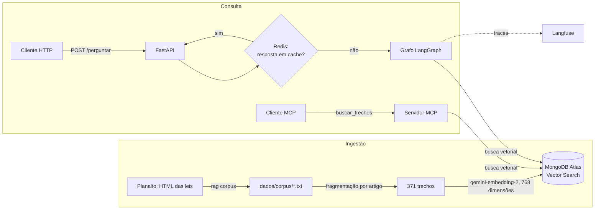
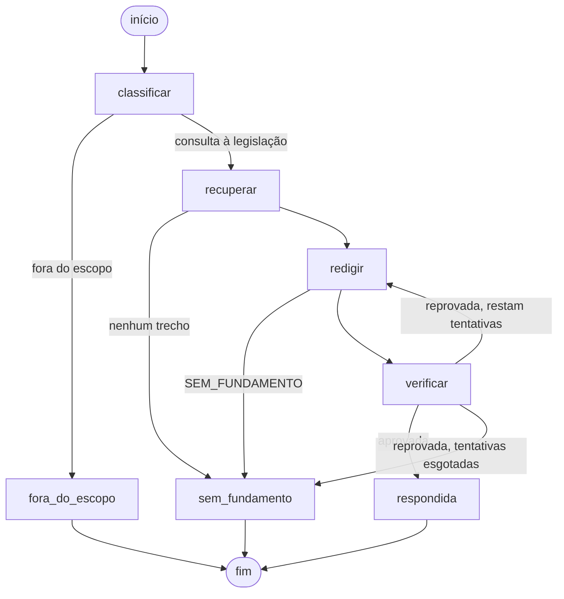

# RAG com agentes sobre legislação brasileira

Sistema de perguntas e respostas sobre cinco atos normativos brasileiros: LGPD, Marco Civil da Internet, Lei de Acesso à Informação, LDB e o Decreto-Lei nº 8.621/1946, que criou o Senac. As respostas citam os artigos usados, e um agente verificador rejeita respostas que não estejam sustentadas pelos trechos recuperados.

O projeto é pequeno de propósito: cada componente existe para demonstrar uma técnica específica, e cada escolha está justificada abaixo.

| Técnica | Onde está |
|---|---|
| RAG com embeddings reais (Gemini) | [`vetorizacao.py`](src/rag_agentes/vetorizacao.py), [`ingestao.py`](src/rag_agentes/ingestao.py) |
| Busca vetorial no MongoDB Atlas Vector Search | [`armazenamento/mongodb.py`](src/rag_agentes/armazenamento/mongodb.py) |
| Milvus atrás da mesma interface | [`armazenamento/milvus.py`](src/rag_agentes/armazenamento/milvus.py) |
| Orquestração de três agentes com LangGraph | [`agentes/`](src/rag_agentes/agentes) |
| Rastreamento de chamadas de LLM no Langfuse | [`observabilidade.py`](src/rag_agentes/observabilidade.py) |
| Cache de respostas no Redis | [`cache.py`](src/rag_agentes/cache.py) |
| API REST com FastAPI e Pydantic | [`api.py`](src/rag_agentes/api.py) |
| Servidor MCP com a busca como ferramenta | [`servidor_mcp.py`](src/rag_agentes/servidor_mcp.py) |
| Conjunto de avaliação versionado | [`avaliacao/perguntas_v1.jsonl`](avaliacao/perguntas_v1.jsonl), [`avaliacao.py`](src/rag_agentes/avaliacao.py) |
| Testes e CI | [`tests/`](tests), [`.github/workflows/ci.yml`](.github/workflows/ci.yml) |

## Arquitetura



A ingestão roda uma vez (e de novo quando o corpus muda). A consulta passa pelo cache; em caso de falta, o grafo de agentes classifica a pergunta, busca os trechos, redige e verifica a resposta. O servidor MCP usa o mesmo índice, mas devolve só os trechos: quem monta a resposta é o LLM do cliente.

### Fluxo dos agentes



O diagrama gerado diretamente do grafo compilado sai de `rag diagrama`.

| Agente | Recebe | Produz | Papel |
|---|---|---|---|
| Classificador | pergunta | categoria e consulta de busca (saída estruturada) | Encerra perguntas fora do corpus antes de gastar busca e redação; reescreve a pergunta sem ruído conversacional. |
| Redator | pergunta e trechos numerados | texto com citações `[n]`, ou `SEM_FUNDAMENTO` | Responde usando apenas os trechos. Na segunda tentativa recebe o motivo da reprovação. |
| Verificador | resposta e trechos | aprovação, motivo, afirmações sem suporte | Etapa determinística (há citação? cada `[n]` existe?) seguida de um LLM que confere cada afirmação contra o trecho citado. |

A recuperação é um nó do grafo, mas não é um agente: não decide nada, só vetoriza a consulta e busca no índice.

## Decisões técnicas

### Corpus: legislação, com o texto revogado removido

Leis brasileiras são públicas (o art. 8º, IV, da Lei nº 9.610/1998 as exclui da proteção de direito autoral), estão em português, têm estrutura explícita e permitem conferir uma resposta: a citação aponta para um artigo que qualquer pessoa pode ler. A LDB e o decreto-lei de criação do Senac entram porque tratam de educação profissional.

O comando `rag corpus` baixa as páginas do Planalto e converte o HTML em texto. As páginas de texto compilado mantêm a redação revogada riscada (`<strike>` ou `text-decoration: line-through`); esse texto é descartado, porque indexá-lo levaria o sistema a citar dispositivos que não vigoram mais. Os arquivos gerados ficam versionados em [`dados/corpus/`](dados/corpus), com as URLs e a data da coleta em [`fontes.toml`](dados/corpus/fontes.toml). Assim testes e avaliação não dependem da disponibilidade do site, e reexecutar `rag corpus` mostra no diff o que mudou na lei.

### Fragmentação por artigo, não por tamanho fixo

Em lei, o artigo é a menor unidade que se sustenta sozinha: um inciso ("III - pela administração pública...") não tem sentido sem o caput que o introduz. Por isso cada artigo vira um trecho, com o caminho estrutural (título, capítulo, seção) guardado como metadado e incluído no texto vetorizado. Artigos acima de 1.500 caracteres são divididos entre incisos e parágrafos, e o caput se repete no início de cada parte. Artigos que só dizem "(VETADO)" ou "(Revogado)" são descartados.

Os identificadores são estáveis e legíveis (`lgpd:art-7`, `lgpd:art-7:parte-2`, `ldb:art-36-B`). O conjunto de avaliação referencia esses identificadores, e um teste falha se uma mudança na fragmentação deixar alguma fonte esperada sem correspondente.

### Embeddings: `gemini-embedding-2`, 768 dimensões

Um único provedor (Gemini) para chat e embeddings significa uma única chave, com camada gratuita. O modelo aceita de 128 a 3.072 dimensões; 768 é uma das três recomendadas pelo fabricante, ocupa um quarto do espaço de 3.072 e o modelo já devolve vetores normalizados nesse tamanho.

Dois detalhes da API influenciam o código. O `gemini-embedding-2` não aceita o parâmetro `task_type`; a tarefa vai como prefixo no texto (`title: ... | text: ...` para documentos, `task: search result | query: ...` para consultas). E enviar uma lista de textos no mesmo `Content` produz um único vetor agregado, por isso cada texto vai num `Content` próprio.

### Índice: MongoDB Atlas Vector Search

O trecho e seu vetor ficam no mesmo documento, e a busca é um estágio `$vectorSearch` de um pipeline de agregação comum, com filtro por documento declarado no índice. O mesmo código atende o Atlas na nuvem e a imagem `mongodb/mongodb-atlas-local` do docker-compose, que roda o mesmo motor de busca localmente.

Parâmetros: similaridade de cosseno; `numCandidates` igual a 20 vezes o `k` (mínimo de 100), o mínimo que a documentação do Atlas recomenda para manter a revocação da busca aproximada. A criação do índice é assíncrona, então `preparar()` espera o índice ficar `READY` antes de devolver.

### Milvus atrás da mesma interface

O restante do sistema depende de um `Protocol` ([`armazenamento/base.py`](src/rag_agentes/armazenamento/base.py)) com quatro operações: preparar, substituir os trechos de um documento, buscar e contar. MongoDB e Milvus o implementam, e `ARMAZENAMENTO=milvus` troca um pelo outro. O Milvus devolve o cosseno em [-1, 1]; o adaptador converte para a escala [0, 1] do MongoDB, para que o limiar de pontuação signifique o mesmo nos dois.

Um único teste de contrato ([`tests/apoio.py`](tests/apoio.py)) roda contra o índice em memória usado nos testes, contra o MongoDB Atlas Local e contra o Milvus Lite. É ele que garante que as implementações são de fato intercambiáveis.

### Orquestração: grafo de estados explícito

O LangGraph é usado como máquina de estados, não como laço livre de um agente que decide sozinho o próximo passo. As transições são funções simples sobre o estado, o número de tentativas de redação é limitado (`MAX_TENTATIVAS_REDACAO`, padrão 2) e todo caminho termina em um de três estados: `respondida`, `fora_do_escopo` ou `sem_fundamento`. Isso torna o custo previsível (no máximo 1 + 2 × tentativas chamadas de LLM por pergunta) e permite testar cada caminho com um modelo roteirizado, sem chamar API.

### Verificação em duas etapas

A etapa determinística é gratuita e pega os erros mais grosseiros: resposta sem citação ou com citação para um trecho que não foi recuperado. Só depois um LLM avalia se cada afirmação é sustentada pelo trecho citado. Um veredito contraditório ("fundamentada", mas com afirmações sem suporte listadas) é tratado como reprovação. Quando a resposta é reprovada, o motivo e as afirmações problemáticas voltam ao redator.

### Cache exato no Redis

A chave é o SHA-256 da pergunta normalizada (caixa, espaços e pontuação final) combinada com uma assinatura da configuração que influencia a resposta: modelos, dimensões, `k`, limiar, número de tentativas e versão dos prompts. Mudar qualquer um desses valores muda a chave. Só respostas aprovadas pelo verificador entram no cache, com TTL de 24 horas, e `rag ingerir` limpa o cache ao reindexar. Se o Redis estiver fora do ar, o serviço registra um aviso e responde sem cache.

Um cache semântico (reaproveitar respostas de perguntas parecidas) foi descartado: em texto legal, "o que diz o art. 7º" e "o que diz o art. 8º" têm embeddings muito próximos e respostas diferentes.

### Rastreamento no Langfuse

O `CallbackHandler` do Langfuse para LangChain registra cada chamada de LLM feita dentro do grafo, com prompt, resposta, modelo, tokens e latência, agrupadas sob o nó que as fez. A vetorização da consulta não passa pelo LangChain e é registrada à parte como observação do tipo `embedding`, dentro de uma observação `retriever` que guarda os trechos e pontuações retornados. Tudo fica sob um span raiz `perguntar`.

Sem `LANGFUSE_PUBLIC_KEY` e `LANGFUSE_SECRET_KEY` o rastreamento é desligado. O compose não inclui um Langfuse próprio porque a versão atual exige Postgres, ClickHouse, Redis e armazenamento de objetos; o projeto gratuito em cloud.langfuse.com basta para demonstração.

### API síncrona

As rotas são funções síncronas, executadas pelo FastAPI num pool de threads. Os clientes usados (pymongo, redis-py, o modelo de chat no grafo) são síncronos, e o trabalho é dominado por espera de rede; misturar rotas assíncronas com chamadas bloqueantes travaria o event loop.

### Servidor MCP só com a busca

A ferramenta `buscar_trechos` devolve trechos com referência, seção e pontuação, com filtro opcional por documento. Expor a busca, e não a resposta pronta, deixa o LLM do cliente decidir como usar as fontes, e o servidor não precisa de cota de chat. Os parâmetros são validados (`k` entre 1 e 20, documentos dentro da lista conhecida).

## Como executar

Pré-requisitos: Docker e uma chave gratuita do Gemini ([AI Studio](https://aistudio.google.com/apikey)).

```bash
cp .env.example .env
```

Preencha `GOOGLE_API_KEY` no `.env` (e, opcionalmente, as chaves do Langfuse). Depois:

```bash
docker compose up -d --build
```

```bash
docker compose exec api rag ingerir
```

A API fica em http://localhost:8000/docs.

```bash
curl -s http://localhost:8000/perguntar -H "Content-Type: application/json" -d '{"pergunta": "Por quanto tempo devem ser guardados os registros de conexão à internet?"}'
```

A resposta tem o formato abaixo. `situacao` é `respondida`, `fora_do_escopo` ou `sem_fundamento`; `fontes` traz apenas os trechos citados, na numeração usada no texto.

```json
{
  "pergunta": "...",
  "situacao": "respondida",
  "resposta": "... [1]",
  "fontes": [{"numero": 1, "id": "marco-civil:art-13", "referencia": "Lei nº 12.965/2014, art. 13", "texto": "...", "pontuacao": 0.0}],
  "tentativas": 1,
  "motivo_da_verificacao": "...",
  "em_cache": false
}
```

Outros comandos, dentro do contêiner (`docker compose exec api ...`) ou localmente com `uv run ...`:

| Comando | Efeito |
|---|---|
| `rag perguntar "..."` | Responde pelo grafo e lista as fontes. |
| `rag avaliar` | Mede a recuperação no conjunto de avaliação (só embeddings). |
| `rag avaliar --completo --saida relatorio.json` | Executa o grafo para cada pergunta; consome cota do LLM. |
| `rag corpus` | Baixa novamente as leis do Planalto e regrava `dados/corpus/`. |
| `rag diagrama` | Imprime o grafo de agentes em Mermaid. |
| `rag mcp` | Sobe o servidor MCP em stdio. |

### Servidor MCP num cliente

Com o MongoDB do compose no ar e o projeto instalado localmente (`uv sync`), a configuração de um cliente MCP (Claude Desktop, Claude Code ou IDE) fica assim:

```json
{
  "mcpServers": {
    "rag-legislacao": {
      "command": "uv",
      "args": ["run", "--directory", "/caminho/para/rag-agentes-python", "rag", "mcp"]
    }
  }
}
```

## Avaliação

[`avaliacao/perguntas_v1.jsonl`](avaliacao/perguntas_v1.jsonl) tem 30 perguntas: 27 com o artigo que deve ser encontrado e 3 fora do escopo. O sufixo `_v1` é parte do nome: mudar perguntas ou fontes esperadas cria uma nova versão, para que resultados de versões diferentes não sejam comparados por engano.

| Métrica | Modo | Significado |
|---|---|---|
| `acerto_em_k` | recuperação | Fração das perguntas em que algum artigo esperado aparece entre os `k` primeiros. |
| `revocacao_em_k` | recuperação | Fração média dos artigos esperados encontrados entre os `k` primeiros. |
| `mrr` | recuperação | Média do inverso da posição do primeiro artigo esperado. |
| `classificacao_correta` | completo | Fração das perguntas classificadas no escopo certo. |
| `respondidas_no_escopo` | completo | Fração das perguntas no escopo que terminaram aprovadas pelo verificador. |
| `citou_fonte_esperada` | completo | Entre as respondidas, fração que cita o artigo esperado. |

Os números dependem do modelo de embeddings e do índice, então não estão fixados aqui: rode `rag avaliar --saida avaliacao/resultados/recuperacao.json` depois da ingestão. A pasta `avaliacao/resultados/` está no `.gitignore`. O limiar `PONTUACAO_MINIMA` vem desligado (0) e deve ser calibrado com esse relatório.

## Testes

```bash
uv sync --extra milvus
```

```bash
uv run pytest
```

| Grupo | Como roda | O que cobre |
|---|---|---|
| Unitários (padrão) | `uv run pytest` | Extração do HTML, fragmentação (inclusive sobre o corpus real), recuperação, os três agentes e todos os caminhos do grafo, cache, API, servidor MCP e métricas da avaliação. |
| Milvus | junto com os unitários, quando o Milvus Lite está instalado (Linux e macOS) | Teste de contrato do adaptador do Milvus. |
| Integração | `uv run pytest -m integracao`, com `docker compose up -d mongodb redis` | Teste de contrato contra o MongoDB Atlas Local (`$vectorSearch` real) e cache no Redis real. |

Nenhum teste chama a API do Gemini. O LLM é substituído por um modelo roteirizado que devolve respostas pré-definidas e registra o que recebeu, e o vetorizador por um saco de palavras com hashing, determinístico. Esses dublês ficam em [`tests/apoio.py`](tests/apoio.py) e não são usados fora dos testes.

O CI ([`.github/workflows/ci.yml`](.github/workflows/ci.yml)) tem dois jobs: lint (ruff), formatação, tipos (mypy em modo estrito) e testes com cobertura mínima de 80%; e integração, com MongoDB Atlas Local e Redis como serviços do GitHub Actions.

## Estrutura

```
dados/corpus/            textos das leis e fontes.toml (URLs e data da coleta)
avaliacao/               conjunto de avaliação versionado
src/rag_agentes/
  corpus.py              coleta no Planalto e conversão de HTML para texto
  fragmentacao.py        divisão por artigo
  vetorizacao.py         embeddings com o Gemini
  armazenamento/         interface do índice, MongoDB e Milvus
  recuperacao.py         consulta ao índice com limiar de pontuação
  ingestao.py            corpus -> trechos -> vetores -> índice
  agentes/               classificador, redator, verificador e o grafo
  cache.py               cache de respostas no Redis
  observabilidade.py     rastreamento no Langfuse
  servico.py             montagem dos componentes a partir da configuração
  api.py                 FastAPI
  servidor_mcp.py        servidor MCP
  avaliacao.py           métricas e execução da avaliação
  cli.py                 comando `rag`
tests/
```

## Limitações conhecidas

- As respostas descrevem o texto das leis indexadas; não são orientação jurídica, não consideram regulamentos, jurisprudência nem outras leis.
- O corpus é uma fotografia de 17/10/2026. Alterações posteriores nas leis só entram com `rag corpus` seguido de `rag ingerir`.
- O verificador é um LLM e pode errar nos dois sentidos. A etapa determinística é sintática: confere que `[n]` aponta para um trecho recuperado, não o que o trecho diz.
- A API não tem autenticação nem limite de requisições; ambos são necessários antes de qualquer exposição pública.
- Na camada gratuita do Gemini os limites de requisições por minuto são baixos; `rag avaliar --completo` faz até cinco chamadas por pergunta.
